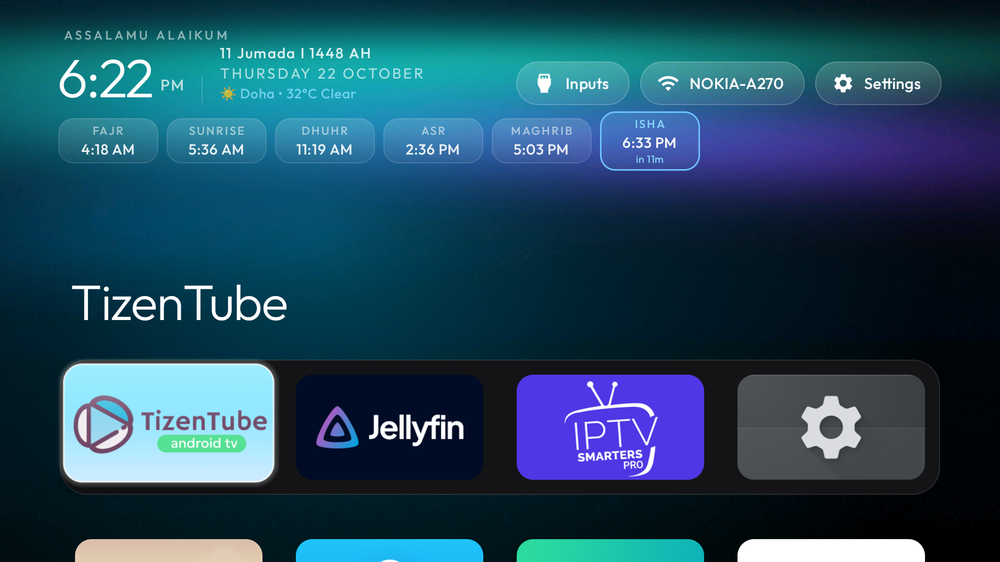

# 🌙 Noor TV Launcher (Vibe Code TV)
### Minimalist, Ad-Free Android TV Launcher with Integrated Islamic Prayer Times & Standby Azan Alerts



A fast, elegant, distraction-free home screen for Android TV and Google TV devices, purpose-built for Muslim households. It combines an Apple TV-inspired aesthetic with accurate Salah times, Islamic calendar display, Azan audio alerts (including TV sleep/standby mode wakeups), and power-efficient screen management.

---

## 🙏 Credits & Acknowledgments

This project is built upon the wonderful lightweight launcher foundation by **[Gathin23 / CleanYourTV](https://github.com/Gathin23/cleanyourtv)** ([@gathint](https://x.com/gathint)). 

Huge credit and gratitude to Gathin for creating the ultra-responsive native Android TV launcher architecture, custom glassmorphism UI, and bloatware-free philosophy.

---

## ✨ Features

### 🕌 Islamic Prayer Times & Hijri Calendar
- **Live Prayer Times**: Accurate daily calculation for **Fajr, Sunrise, Dhuhr, Asr, Maghrib, and Isha** pinned directly on the home screen.
- **Dynamic Countdown**: Highlights the upcoming prayer with a real-time countdown badge (e.g. *ISHA in 10m*).
- **Multiple Calculation Authorities**:
  - Umm Al-Qura (Qatar, Saudi Arabia, Gulf)
  - Muslim World League (MWL)
  - Egyptian General Authority of Survey
  - University of Islamic Sciences, Karachi
  - Islamic Society of North America (ISNA)
  - Kuwait
  - Dubai (UAE)
- **Manual Adjustments**: Fine-tune individual prayer times by +/- minutes to match your local mosque.
- **Islamic Greeting**: Traditional *"Assalamu Alaikum"* (or *"السلام عليكم"* in Arabic) header greeting.
- **Hijri Date**: Automatic Hijri date calculation with +/- 2 day lunar sighting adjustments.

### 📢 Azan Audio & TV Sleep / Standby Mode Wakeup
- **Authentic Adhan Sounds**: Choose between Makkah, Madinah, and Al-Aqsa recordings.
- **TV Sleep Mode Support**: Uses exact Android `AlarmClock` triggers and wake locks to sound the Azan even when the TV display is powered off or in standby.
- **TV Overlay Banner**: Displays a non-intrusive prayer time overlay banner across other applications (YouTube, IPTV, media players).
- **In-App Testing**: Built-in test buttons for Azan audio and alert overlay banners.

### 📺 Smart Screensaver & Display Power Management
- **Screen Saver vs. Deep Sleep**: Choose whether idle timeouts activate a sleek clock screensaver or completely turn off the TV display to save energy and protect panels.
- **System Synchronization**: With `WRITE_SECURE_SETTINGS`, the launcher automatically overrides `stay_on_while_plugged_in` and syncs system sleep settings so Android TV panels turn off properly even when plugged into AC power.
- **Accessibility Integration**: Built-in accessibility service enables direct TV display sleep via global lock screen actions.

### 🚀 Clean, Lightweight Native Launcher
- **Ultra-Fast & Ad-Free**: No sponsored rows, no recommended ads, and zero analytics overhead.
- **Smooth DPAD Navigation**: Intuitive remote-control navigation with glassmorphism focus highlights and ambient glow effects.
- **Customizable App Dock & Grid**: Pin your favorite streaming and media apps to the main dock.
- **Inputs & Status**: Quick access to HDMI inputs, Wi-Fi status, and system settings.

---

## 🛠️ Installation & Setup

### 1. Build the APK
Clone the repository and build the debug APK using Gradle:
```bash
cd launcher
./gradlew assembleDebug
```
The compiled APK will be generated at `launcher/app/build/outputs/apk/debug/app-debug.apk`.

### 2. Connect to Your TV via ADB
Enable Developer Options and USB/Network Debugging on your Android TV:
```bash
adb connect <YOUR_TV_IP>:5555
```

### 3. Install the Launcher
```bash
adb install -r launcher/app/build/outputs/apk/debug/app-debug.apk
```

### 4. Enable Recommended Permissions (for Sleep Mode & Screen Control)
To enable full sleep mode Azan wakeups and complete TV screen power-off control, grant the following permissions via ADB:
```bash
# Allow launcher to control system sleep & screen timeouts:
adb shell pm grant com.gathin.tvhome android.permission.WRITE_SECURE_SETTINGS

# Prevent system from killing Azan background alarms during deep sleep:
adb shell dumpsys deviceidle whitelist +com.gathin.tvhome
```

---

## ⚙️ Configuration

1. Launch **Noor TV Launcher** and click on **Settings** (or press the Settings icon in the top right).
2. Open **Prayer & Azan Settings**:
   - Set your **City and Country** (or use auto-location).
   - Select your preferred **Calculation Method**.
   - Enable **Azan in TV sleep mode** to ensure prayers play when the TV screen is asleep.
   - Pick your desired **Azan sound** and adjust any minute offsets if needed.
3. Open **Screen Saver Settings**:
   - Choose whether the TV displays an idle clock screensaver or turns off the screen when inactive.
   - Adjust the inactivity timeout (from 1 minute to 60 minutes).

---

## 📄 License

This software is released under the [Apache License 2.0](LICENSE). 
Based on original work by [Gathin23](https://github.com/Gathin23/cleanyourtv).
